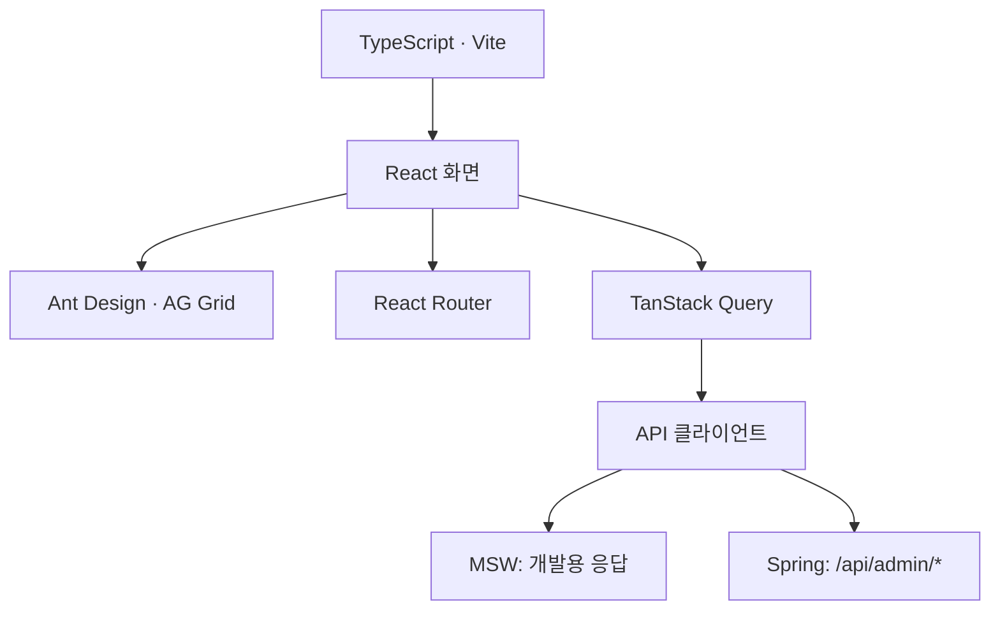

# Environment — 프레임워크 · 라이브러리 인벤토리

현재 사용하는 라이브러리와 용도를 정리했어요. 아래 버전 범위는 2026-11-24 소스 기준이며, 정확한 설치 버전은 `package.json`과 lock 파일에서 확인해요.

## 기술 스택 한눈에 보기

화면 내부 상태는 React 상태로, 서버에서 가져온 데이터는 TanStack Query로 관리해요. API 클라이언트는 실행 설정에 따라 Mock 응답이나 서버 응답을 받아요. [실행 모드를 바꾸는 절차](../guide/derived-repo.md#3-mock--실서버-전환)와 [서버 지원 범위](../api-contract/admin-api.md#mock--실서버-차이)는 각 가이드에서 확인해주세요.

## 코어

| 이름 | 버전 | 용도 |
|---|---|---|
| React | ^19.2 | UI 라이브러리 — antd 6 가 React 19 를 네이티브 지원해요. `@ant-design/v5-patch-for-react-19` 는 이 레포에 없어요 |
| TypeScript | ~7.0 | 언어. `tsconfig.app.json`에서 strict 모드로 검사해요 |
| Vite | ^8.1 | 빌드 · dev 서버 (`npm run dev` → :5173) |

### `skipLibCheck: true` 를 끄지 마세요

`tsconfig.app.json`과 `tsconfig.node.json`에서 외부 라이브러리 선언 파일 검사를 생략하고 있어요. 이 설정을 바꿀 때는 의존성 타입 호환성을 다시 확인해주세요. 앱 코드는 `tsc -b`로 검사하며, 검사 시간은 개발 환경에 따라 달라요.

## UI

| 이름 | 버전 | 용도 |
|---|---|---|
| Ant Design (antd) | ^6.5 | 컴포넌트 — `ConfigProvider` 토큰은 `src/lib/theme.ts` (아래 각주) |
| ag-grid-community / ag-grid-react | ^36.0 | 서버 페이지네이션 그리드 (Theming API) |
| lucide-react | ^1.25 | 아이콘 — `src/lib/icons.tsx` 가 antd 아이콘 이름으로 재-export |
| @xyflow/react · @dagrejs/dagre | ^12.11 · ^3.1 | ERD 콘솔(시스템 설계도) 그래프와 자동 배치 — `SchemaPageLazy` 로 지연 로드 |
| @storkspear/post-editor-core · -react | ^0.5.7 | 게시물 편집기(작성·수정)와 게시용 HTML 생성(`toPublishedHtml`) — npm 공개 패키지, 두 개를 같은 판으로. `@tiptap/*` 3.31.3 은 이 패키지의 peer |
| dompurify | ^3.4 | 게시물 HTML 본문 정화(`src/lib/sanitizeHtml.ts`) — 직접 의존성으로 선언해 사용해요 |
| react-markdown · remark-gfm | ^10.1 · ^4.0 | 옛 markdown 게시물 렌더(`PostBody`) |
| dayjs | ^1.11 | 날짜 포맷 |
| 자체 차트 | — | `MiniBarChart` · `MiniPieChart` · `Sparkline` · `StackedBarChart` (외부 차트 라이브러리 없음) |

### antd 5 코드를 가져올 때 — antd 6 이관 기준표

파생 레포에서 antd 5 시절 코드를 가져올 때 이 표를 기준으로 보면 돼요. antd 5 → 6 에서
실제로 바뀐 지점을 **antd 6.5.3 의 타입 정의로 직접 확인한 결과**예요.

| antd 5 | antd 6 | 상태 |
|---|---|---|
| `Modal` `styles.content` | `styles.container` | **필수** — semantic 키에 `content` 가 없어요 |
| `Divider` `orientation="left\|right\|center"` | `titlePlacement` | **의미 변경 주의** — `orientation` 은 남아 있지만 이제 축(`horizontal\|vertical`)을 뜻해요. 값도 `start`/`end` 가 정본이고 `left`/`right` 는 RTL 보정을 거치는 별칭이에요 |
| `Divider` `type` | `orientation` | deprecated |
| `Space` `direction` | `orientation` | deprecated |
| `Tag` `bordered={false}` | `variant="filled"` | deprecated (아직 동작) |
| `Statistic` `valueStyle` | `styles.content` | deprecated (아직 동작) |
| `antd/es/table` 의 `ColumnsType` | `antd` 의 `TableColumnsType` | 내부 경로 import 회피 |
| `Alert` `message` | `title` | deprecated |
| `Modal` `maskClosable` | `mask={{ closable: true }}` | deprecated |
| `Divider` `orientationMargin` | `styles.content.margin` | deprecated |
| `Drawer` `width` · `height` | `size` | deprecated (아직 동작). 숫자·CSS 길이·`'100%'` 모두 그대로 받아요 |
| `Drawer` `styles.content` | `styles.section` | **필수** — `content` 는 deprecated 이고 DOM 에 적용되지 않아요 |

> deprecated 속성은 타입 검사만으로 발견하지 못할 수 있어요. 화면 테스트는 렌더링 중 출력되는 deprecation 경고를 검사해요. 정상·서버 오류·네트워크 오류 테스트가 있지만 모든 화면 상태를 빠짐없이 렌더링하는 것은 아니므로, 바꾼 컴포넌트의 상태도 직접 확인해주세요.

**바꾸지 않아도 되는 것** — antd 6 에서도 그대로 유효한 API 예요.

| API | 확인 결과 |
|---|---|
| `Descriptions.Item` children | deprecated 아님. `items` prop 과 **둘 다 유효**해요 |

- **`@ant-design/v5-patch-for-react-19` 는 반드시 제거**해야 해요. antd 6 는 React 19 를 네이티브 지원하고, 패치가 남아 있으면 충돌해요.
- `destroyOnHidden`(5.25 도입, `destroyOnClose` 의 후계)은 6 에서도 그대로예요 — `MediaModal` · `FileDetailDrawer` · `UserDetailDrawer` · `useReasonModal` · `ContentComposePage` · `RolesPage` 가 쓰고 있어요.
- 중첩 `ConfigProvider`는 해당 영역의 테마나 팝업 설정을 바꿀 때 사용해요. 수정 후 라이트·다크 모드와 팝업 표시를 함께 확인해주세요.

### CSS 리셋

이 레포에는 Tailwind 가 없어요. 기본 스타일 초기화는 `src/index.css` 상단의
`@import 'antd/dist/reset.css'` 가 담당해요. `postcss` · `autoprefixer` 도 직접 의존이 아니에요
(`postcss` 는 vite 8 의 직접 의존이라 트리에는 남아요).

## 데이터

| 이름 | 버전 | 용도 |
|---|---|---|
| TanStack Query | ^5.62 | 서버 상태 — 목록은 `useAdminList` 훅 |
| react-router | ^8.3 | 라우팅 — `src/nav.tsx` 의 `NAV_ITEMS` 가 단일 소스. import 는 `react-router` 패키지에서 해요 (`react-router-dom` 은 이 레포에 없어요) |
| MSW | ^2.7 | mock — 전 화면이 백엔드 없이 동작, `VITE_USE_MOCK=false` 로 실서버 전환 |

## 개발 도구

| 이름 | 버전 | 용도 |
|---|---|---|
| oxlint | ^1.71 | 린트 |
| tsc -b | — | 타입 검사 — `npm run build` 게이트 |
| Vitest | ^4.1 | 화면·상태·유틸리티 테스트. `npm test`와 push 전 검사에서 실행해요 |
| @testing-library/react · jsdom | ^16.3 · ^30.0 | 스모크 렌더 — `src/mocks/handlers.ts` 를 `msw/node` 로 재사용 |

## 백엔드 계약

짝 백엔드는 [`template-spring`](https://github.com/storkspear/template-spring) 의 `/api/admin/*` 이에요. 엔드포인트·에러 코드·RBAC 계약은 [`api-contract/admin-api.md`](../api-contract/admin-api.md) 가 정본이에요.

## 관련 문서

- [루트 `README.md`](../../README.md) — 빠른 시작 · 화면↔엔드포인트 매핑
- [루트 `CLAUDE.md`](../../CLAUDE.md) — 단일 소스 표 · 컨벤션 5분 요약
